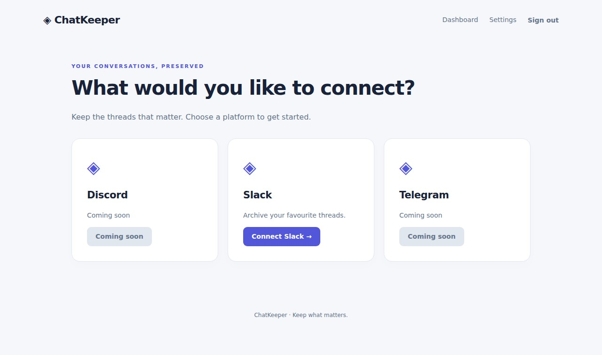
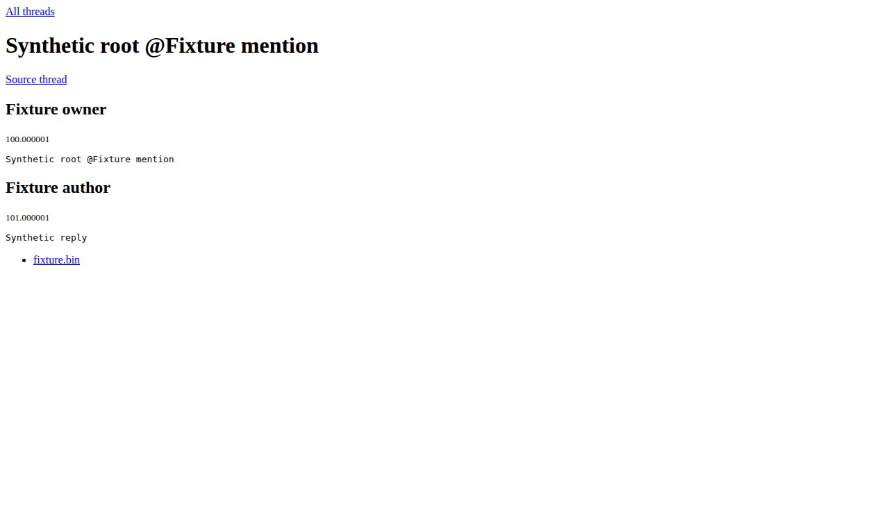

# ChatKeeper

Keep chat threads that matter. Mark a thread with a reaction and ChatKeeper saves
its messages and attachments in a verified, portable archive. Search in your
browser or give an agent read-only access through REST or MCP.

One static Go binary runs on your desktop or server. Slack capture is available;
Discord and Telegram are planned. Capture never deletes source messages. MIT licensed.




## Install

### Homebrew (macOS and Linux)

```sh
brew install bitskyai/tap/chatkeeper            # CLI + local server (formula)
brew install --cask bitskyai/tap/chatkeeper-app # macOS menu-bar app (bundles the server)
```

Run `chatkeeper` to open the local setup wizard, or keep it running in the
background with `brew services start chatkeeper` and run `chatkeeper` again to
open the browser UI of the running instance. Install one or the other for
day-to-day use: both share the same data folder and instance lock, so the app
attaches to a running `brew services` server rather than starting a second one.
Upgrade with `brew upgrade chatkeeper` / `brew upgrade --cask chatkeeper-app`.
The tap is [bitskyai/homebrew-tap](https://github.com/bitskyai/homebrew-tap) and
receives stable releases only; prereleases are download-only.

### Direct download

Download the archive for your OS and CPU from
[GitHub Releases](https://github.com/bitskyai/chatkeeper/releases), extract it and run
the binary. Your browser opens the local setup wizard: connect Slack, select
channels, choose root reactions, and test capture.

| OS | Archive | Run |
| --- | --- | --- |
| macOS, Apple silicon | `chatkeeper_VERSION_darwin_arm64.tar.gz` | `./chatkeeper` |
| macOS, Intel | `chatkeeper_VERSION_darwin_amd64.tar.gz` | `./chatkeeper` |
| Linux x86-64 / arm64 | `chatkeeper_VERSION_linux_amd64.tar.gz` / `_linux_arm64` | `./chatkeeper` |
| Windows x86-64 / arm64 | `chatkeeper_VERSION_windows_amd64.zip` / `_windows_arm64` | `.\chatkeeper.exe` |

Use `./chatkeeper --no-browser` to print the launch URL. The desktop listener is
loopback-only. macOS binaries are not notarized and Windows binaries are not
Authenticode signed yet. After verifying the download, use your OS's explicit
approval flow for an unsigned app. On macOS, if necessary:
`xattr -d com.apple.quarantine ./chatkeeper`.

### macOS menu-bar app

`ChatKeeper-VERSION.dmg` on each release (or the `chatkeeper-app` cask above) is a
universal (Apple silicon + Intel) menu-bar app for macOS 13+. It runs the bundled
server in the background and shows its status (running, capturing, paused, needs
attention). From the menu you can open ChatKeeper in the browser, jump to the five
most recent archives, pause or resume capture, start at login, and check for updates.
It shares the CLI's data folder and instance lock, so if `chatkeeper` or
`brew services` is already running the app attaches to it.

v0.1 is **not signed with an Apple Developer ID**. After dragging it to
Applications, right-click (Control-click) ChatKeeper → **Open** → **Open** once. On
macOS 15+, use System Settings → Privacy & Security → **Open Anyway**. Or run
`xattr -dr com.apple.quarantine /Applications/ChatKeeper.app`. The Homebrew cask
does this for you. Building and signing details: [desktop/macos](desktop/macos/README.md).

Before running a download, verify its checksum and GitHub provenance:

```sh
# Download SHA256SUMS with your archive; check the matching line:
sha256sum --ignore-missing --check SHA256SUMS   # macOS: shasum -a 256 -c SHA256SUMS
# GitHub CLI verifies the artifact against the repository's attestation:
gh attestation verify chatkeeper_VERSION_linux_amd64.tar.gz --repo bitskyai/chatkeeper
```

Releases include six archives, SHA256SUMS and per-archive Syft SBOMs. GitHub build
attestations cover archives, SBOMs and checksums. The macOS app's
`ChatKeeper-VERSION.dmg` and `.zip` are listed in their own
`ChatKeeper-VERSION.sha256` (not in SHA256SUMS) and are attested too:

```sh
shasum -a 256 -c ChatKeeper-VERSION.sha256
gh attestation verify ChatKeeper-VERSION.dmg --repo bitskyai/chatkeeper
```

The container image has BuildKit SBOM and
provenance plus a GitHub attestation. Keyless cosign signing is optional and is
not enabled; do not expect `.sig` files.

## Server: Docker Compose or Helm

Server mode supports administrator sign-in and a read-only API bearer. Put network
access behind a TLS reverse proxy and restrict inbound access.

```sh
cd deploy/compose
cp .env.example .env
# Edit .env: set a unique administrator password (12+ characters), image version,
# allowed hosts, and CHATKEEPER_SECURE_COOKIES=1 when using HTTPS.
docker compose up -d
```

Open `http://localhost:8787/login`. Compose binds loopback by default and persists
configuration, secrets, indexes and archives in a named volume. Pin a released
`v*` image tag for production. A configured admin password is reapplied at every
restart; rotate the environment value when rotating that password. To use a
one-time setup code instead, omit the password environment entry, read the code
from container logs, and visit `/bootstrap`.

```sh
kubectl create secret generic chatkeeper --from-literal=admin-password='YOUR-LONG-RANDOM-PASSWORD'
helm upgrade --install chatkeeper deploy/helm/chatkeeper --set image.tag=vVERSION
kubectl port-forward service/chatkeeper 8787:8787
```

The chart deploys a single writer with Recreate updates, a PVC, ClusterIP service,
non-root security context and `/healthz` startup/readiness/liveness probes. Set
`existingSecret`, `envFromSecrets` (platform credentials), `persistence.existingClaim`,
`persistence.storageClass` and `resources` as needed. It creates no Ingress or
credential Secret. Use a TLS ingress/proxy and an explicit Host allowlist for
remote access (for example `--set allowedHosts=chatkeeper.example.com --set secureCookies=true`; then use the HTTPS hostname instead of port forwarding). The app creates its private home at `/data/chatkeeper` on the PVC. `/healthz` reports process availability, not workspace capture health.
Back up the volume before upgrades; keep only one writer per archive.

To build from source, use Go 1.26+: `go build -trimpath -o chatkeeper ./cmd/chatkeeper`.
The Slack plugin vendors standard emoji short names and glyphs generated from
[iamcal/emoji-data](https://github.com/iamcal/emoji-data) (MIT, see
`internal/plugins/slack/emoji/LICENSE`). The source commit and SHA-256 are pinned
in `tools/generate-emoji.py` and `internal/plugins/slack/emoji/NOTICE`; the
generator refuses an input whose hash differs.
To build a container: `docker build -t chatkeeper:local .` (BuildKit required).

## Slack app setup

The wizard guides these steps and checks credentials before saving a workspace.
A coding agent can do the same from a terminal: see
[Set up with a coding agent](docs/agent-setup.md) (`chatkeeper setup slack
--print-manifest`, `--dry-run`, then save; the wizard's first page has a
copyable prompt).

1. Create a Slack app in your workspace from the wizard's manifest (bot scopes
   `channels:history`, `channels:read`, `groups:history`, `groups:read`,
   `reactions:read`, `users:read`, `files:read`; optional `emoji:read` adds custom
   workspace emoji to the reaction picker). Install it and copy the bot token,
   then click **Test connection** to see the workspace, bot user and every
   granted or missing scope.
2. Slack's Install App page shows only the bot token. For instant capture you
   also need an app-level token (`xapp-`). Slack has no API that creates one, so
   the wizard looks up your workspace and app from the bot token and shows six
   numbered steps with copy buttons: open **Basic Information**
   (`https://app.slack.com/app-settings/<team>/<app>/general`), under
   App-Level Tokens click **Generate Token and Scopes**, name it `chatkeeper`,
   add the single scope `connections:write`, generate and copy the token, check
   **Enable Socket Mode** (`.../socket-mode`), paste and save. The step shows
   only a one-line bot token summary, not the previous checklist. **Test
   connection** opens a real Socket Mode session and checks the token belongs
   to the same app as the bot token, freshly resolved from the bot token (it
   fails closed when either app id cannot be confirmed); revoked tokens, a missing scope, the wrong
   token type, another app's token or Socket Mode switched off each show the
   exact fix and link. The manifest already enables Socket Mode and subscribes
   `reaction_added`, `reaction_removed`, `message.channels` and
   `message.groups`. Without an app token choose **Continue with polling only**
   (checks every two minutes); the dashboard's **Enable instant capture**
   reopens this step later.
3. Invite the bot to each watched channel, including private channels, then
   select channels and one or more reactions. Every step has **Back**; entered
   values are kept and secrets stay server-side (shown as saved).
4. Add a selected reaction to a thread. With Socket Mode connected, a reaction
   on **any message in the thread** (the first message or a reply) archives the
   whole thread: ChatKeeper maps the reacted reply to its thread root with one
   cached `conversations.replies` read. Polling reads only reactions on the
   **first message** (one history read per channel per poll), so in polling-only
   mode, or for a reply reaction added while Socket Mode was disconnected, react
   on the first message. Skin tones count: `+1` matches `+1::skin-tone-N` of any
   tone; configure `+1::skin-tone-3` to require one tone. The wizard writes
   `trigger.match: any`; without `match` (or with `match: all`) every listed
   reaction must be on the root, as in earlier releases. An owner rule requires a
   selected owner to supply the matching reactions. Removing a trigger stops
   future refreshes and keeps the existing archive.
5. On the live test, **Check now** scans immediately and shows a log: channels
   and bot membership, thread roots scanned, reactions found, and why nothing
   matched. The dashboard lists recent capture events.

Polling also runs with Socket Mode and repairs missed events. Each poll rescans
thread roots posted in the last 24 hours, because a reaction can land on an
older root at any time; a full history scan runs hourly and on **Check now**.
When Slack answers HTTP 429, its `Retry-After` is honored across polls and
reconnects: reads pause until the cooldown ends instead of retrying early.

For managed YAML, copy [examples/config.yaml](examples/config.yaml) and replace
synthetic IDs and credential environment names. Storage paths resolve relative to
that YAML. Server paths are confined to `<app home>/data`. Read-only managed YAML
can be exported from the wizard and applied externally.

## Search and agents

Browser search supports SQLite FTS5 phrases, prefixes, boolean operators and
`NEAR`; literal CJK text uses substring matching. Prior edits and messages deleted
at source remain searchable. The archive viewer shows those annotations.

Claude Code stdio MCP configuration (`.mcp.json`, use an absolute binary path):

```json
{"mcpServers":{"chatkeeper":{"command":"/absolute/path/chatkeeper","args":["mcp","--config","/absolute/path/config.yaml"],"env":{"CHATKEEPER_HOME":"/absolute/path/app-home"}}}}
```

Codex MCP configuration (`~/.codex/config.toml`):

```toml
[mcp_servers.chatkeeper]
command = "/absolute/path/chatkeeper"
args = ["mcp", "--config", "/absolute/path/config.yaml"]
env = { CHATKEEPER_HOME = "/absolute/path/app-home" }
```

Tools: `search_threads`, `get_thread`, `list_workspaces`. Stdio reads local archives
and emits JSON-RPC only on stdout. Stdio also offers read-only `setup_status`
(credential presence only, never values) and `validate_setup` (re-runs the
connection tests with stored credentials, redacted); with no config yet it
starts with only those two tools; see
[agent setup](docs/agent-setup.md). Use the same home
as the running app to share its index. REST offers `GET /api/search`,
`GET /api/threads/{workspace}/{channel}/{ts}` and `GET /api/openapi.json`.
HTTP MCP is `/mcp` and always requires a configured read-only bearer:
`Authorization: Bearer <CHATKEEPER_API_TOKEN>`. The bearer grants all configured
workspaces, never administrator access. HTTP MCP uses stateless JSON responses.

## Privacy and security

Your archive stays on your filesystem; there is no hosted ChatKeeper service.
Source APIs receive normal capture requests. ChatKeeper stores messages,
attachments and history in plaintext files; use disk encryption and protected
backups. Agents with local filesystem or API access can read archived content.

Desktop credentials use the OS keychain when available, otherwise a private
`secrets.env` file. Environment values take precedence. Server credentials use
environment variables or that file. Secrets are not stored in workspace YAML.
App home defaults to the OS configuration directory's `chatkeeper` folder;
`CHATKEEPER_HOME` overrides it. Desktop archives default to `~/ChatKeeper/<workspace>`.
Browser sessions expire after 12 hours. Server setup uses a one-time code or
`CHATKEEPER_ADMIN_PASSWORD`; set secure cookies when terminating HTTPS at a proxy.
Forwarded headers are not trusted. Compiled plugins are trusted in-process code.

Archive files and SHA-256 manifests are authoritative. Search indexes are derived
and rebuildable. Back up archives, YAML, application state and cleanup journals;
store credential backups separately. On Windows, directory fsync is unavailable,
so power-loss durability depends on filesystem behavior. Read the
[security policy](SECURITY.md) for private vulnerability reporting.

## Commands and development

`chatkeeper --help` lists commands and flags. Common maintenance:

```sh
chatkeeper check-config --offline --config config.yaml
chatkeeper setup slack --help   # non-interactive setup, JSON result
chatkeeper backfill --config config.yaml
chatkeeper verify --config config.yaml
chatkeeper version
```

`verify` checks snapshots without source calls and fails on corruption. It may
create locks or recover an interrupted rename; use a copy for migration rehearsals.
`run` reloads valid YAML and credential changes; listener changes need a restart.
Workspace removal keeps archives. See [CONTRIBUTING](CONTRIBUTING.md),
[architecture](docs/design/architecture.md), [porting details](docs/porting.md),
[launch checklist](docs/launch-checklist.md) and [MIT license](LICENSE).

### Opt-in source cleanup

Cleanup is off by default. It deletes source messages only after verifying the
exact durable archive, a live identity, owner approval reaction and unchanged
live content. Slack bot credentials can delete only their own messages. Deleting
others requires a user admin/owner credential and explicit `allow_others: true`.

In **Settings → workspace → Delete from Slack after archiving**, configure
cleanup without editing YAML. Setup also offers **Clean up Slack (optional)**
after the capture test; skip it to leave cleanup off. Pick yourself from named
workspace members as the first allowed approver. Delete approvals default to
`:wastebasket:` and remain separate from the archive trigger. Choose whole-thread
approval on the root or individually approved messages (roots containing replies
are preserved in message scope). Minimum age defaults to 24 hours; zero requires
**Allow immediate**. **Delete messages posted by others** is a separate opt-in.

The deletion token field writes only to the credential store. **Test** verifies
workspace identity, token owner, scopes and admin/owner status when allowing
others. For a user token, open the linked OAuth & Permissions page, add
`chat:write`, `users:read`, `channels:history` and `groups:history` under **User
Token Scopes**, reinstall and copy the **User OAuth Token** (`xoxp-`). History
scopes support the live thread comparison; `users:read` verifies the owner.
Bot-only cleanup uses `xoxb-` with the same scopes under **Bot Token Scopes**.
Slack workspace permissions still apply. App links use
`https://app.slack.com/app-settings/<TEAM_ID>/<APP_ID>/oauth`.

For YAML-managed workspaces the form is read-only. The equivalent policy is:

```yaml
cleanup:
  enabled: true
  token_env: CHATKEEPER_CLEANUP_TOKEN
  min_age_hours: 24
  # Zero requires an explicit allow_zero_age: true opt-in.
  allow_others: false
  own_only: true
  scope: thread  # or messages: each target needs its own approval
  approval:
    who: owner
    owners: [UOWNER]  # use your workspace member ID
    reactions: [wastebasket]
    match: any
  every_hours: 0  # automatic apply OFF; set >= 1 to opt in
```

Legacy YAML without `cleanup.approval` retains its archive-trigger approval
behavior. New UI settings write a separate cleanup approval policy.

Set the referenced secret in the environment or credential store. Preview is
offline and needs no credential:

```sh
chatkeeper cleanup --workspace example
chatkeeper cleanup --workspace example --apply
```

**Run automatically every N hours (apply)** defaults off. Enabling it explicitly
authorizes scheduled deletion with the same bound-preview, archive integrity,
live comparison, owner, age, author and journal checks. Per-message receipts and
run results persist in the cleanup log. **Disable cleanup** and **Stop automatic
cleanup** remain available during a source outage.

The authenticated **Cleanup** page links to these settings and explains blocked
previews, missing credentials/owners, author opt-ins and the eligibility time for
recent threads. Its credential warnings use read-only live identity checks;
the CLI/engine preview remains offline. The page offers per-workspace enable, preview and
apply. Apply requires typing the workspace id, a fresh unchanged preview, and
administrator password re-entry in server mode. Each thread reports dry-run,
deferred, cleaned, deleted, unknown/pending, refused, rate-limited or blocked.
Rate-limit exhaustion skips remaining threads. Web apply runs independently of
the browser request, with a progress page that refreshes during the run.
Unknown/pending previews cannot authorize web apply; refresh the archive or
explicitly resume from the CLI for live reconciliation. Pending outcomes are
never assumed successful.

Keep the `cleanup/` journals with your archive. Deletion timestamps are stored
there as `source_deleted_at` metadata so original snapshot bytes and hashes stay
unchanged until refresh folds confirmed markers into the next snapshot.
Refresh/backfill never shrink an archive and archive new replies after cleanup.
The viewer and dashboard show cleaned, partial, stale or unknown/pending status.
A stale journal is reconciled against the folded markers on the next cleanup.
Folder storage on systems with durable directory sync is
supported; Windows apply and unsupported storage types fail closed.

The Helm cleanup CronJob has separate `cleanup.enabled`, `cleanup.workspace`
and `cleanup.apply` opt-ins; its default execution is a dry-run.
**Warning:** `cleanup.apply: true` schedules destructive source deletion without
the web confirmation step. Enable it only after reviewing a dry-run and the
workspace age, owner and credential policies. The real Slack gates verify
deletion, viewer markers, tamper refusal, refresh/backfill retention and new
reply capture after partial cleanup.

Persistent diagnostics: see [logging and platform paths](docs/logging.md). Slack compatibility fixtures, fuzzing, live results and remaining coverage gaps are documented in the [corpus audit](docs/slack-corpus.md).
